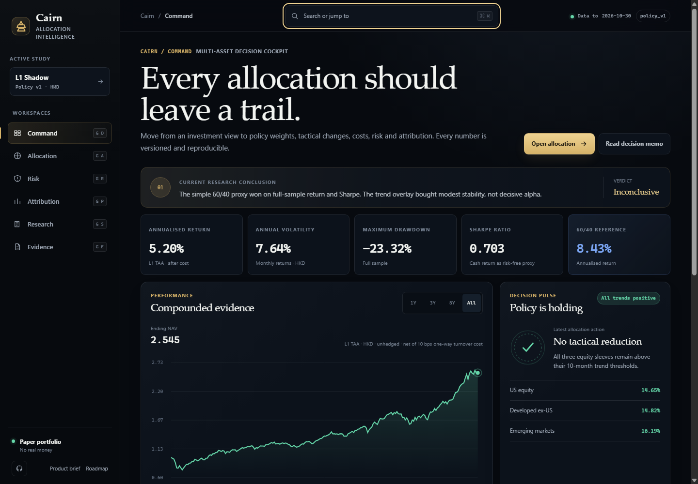

# Cairn

**Insurance-aware Multi-Asset Allocation Lab**

<p align="center">
  <a href="https://aayloo.github.io/cairn-allocation-lab/">
    
  </a>
</p>

<p align="center">
  <a href="https://aayloo.github.io/cairn-allocation-lab/"><strong>Open the live interactive product →</strong></a>
  &nbsp;·&nbsp;
  <a href="docs/5-minute-investment-case.md">Five-minute investment case</a>
  &nbsp;·&nbsp;
  <a href="docs/PRODUCT_ROADMAP.md">Product roadmap</a>
</p>

Cairn is a research cockpit for turning an investment view into an inspectable
portfolio decision. It connects strategic allocation, tactical signals,
constraints, currency translation, transaction costs, risk and attribution in
one reproducible workflow.

**Click the preview above or use the link to open the interactive product.**

> Paper research portfolio only. Cairn contains no real money, broker orders,
> personal account or investment advice.

## Why this exists

Most portfolio projects stop at a backtest chart. Cairn exposes the rest of the
decision chain:

1. What is the strategic policy?
2. What changed at the latest month-end?
3. How do current weights deviate from policy?
4. Which risk dominates the portfolio?
5. Where did return come from?
6. Can every result be reproduced and audited?

The current full-sample result is deliberately not flattering: the 60/40 proxy
beat the static policy and trend overlay on return and Sharpe. Cairn keeps that
negative result visible rather than tuning the rules after seeing the answer.

## Product workspaces

- **Command** — latest decision, KPIs and portfolio pulse.
- **Allocation** — policy weights, current drift and mandate constraints.
- **Risk** — capital versus variance contribution and stress agenda.
- **Attribution** — return sources and calendar-year dispersion.
- **Research** — hypothesis, decision record and falsification conditions.
- **Evidence** — data lineage, result contract, artifact hashes and downloads.

## Research design

- 40% equities: SPY, VEA, EEM
- 35% fixed income and credit: IEF, LQD
- 10% gold: GLD
- 5% commodities: DBC
- 10% short-term bills: BIL
- Monthly rebalancing
- 10 bps cost per unit of one-way turnover
- 10-month trend rule applied independently to equity sleeves
- Unhedged HKD translation from USD proxies
- Fixed evaluation start: June 2008

The static SAA is the primary comparator. A 60/40 proxy and equal-weight basket
are external references.

## Reproduce

```bash
python -m pip install -e ".[dev]"
python scripts/build_case.py
python -m pytest -q
python -m http.server 8000
```

Open <http://localhost:8000>.

The build downloads adjusted closes from Yahoo Finance through `yfinance`. Raw
vendor data is stored under the ignored `data/` directory and is not
redistributed. Versioned outputs used by the website live under `assets/data/`.

## Product roadmap

Development is organized around reproducible product capabilities: data
provenance, allocation, risk, attribution, a research decision ledger, scenario
analysis and portfolio-ready exports.

See [the product roadmap](docs/PRODUCT_ROADMAP.md) and
[the product brief](docs/PRODUCT_BRIEF.md).

## Reference principles

The product draws inspiration from:

- [Fincept Terminal](https://github.com/Fincept-Corporation/FinceptTerminal):
  dense financial workspaces, visible analytics and modular research surfaces.
- [FinRobot](https://github.com/AI4Finance-Foundation/FinRobot): deterministic
  computation separated from LLM narration, with provenance and auditability.

Neither project's code or visual assets are copied into Cairn.

## Limitations

- Paper portfolio only.
- Adjusted-close approximation.
- Flat transaction-cost assumption.
- No market impact, tax or broker execution.
- Broker or live execution is out of scope.
- No claim of statistically significant alpha.
- Historical public-data results do not guarantee future returns.

See [DISCLAIMER.md](DISCLAIMER.md).
